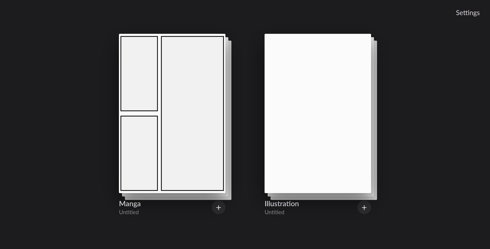
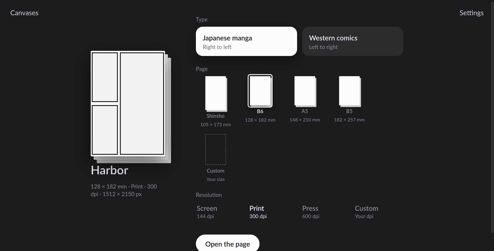
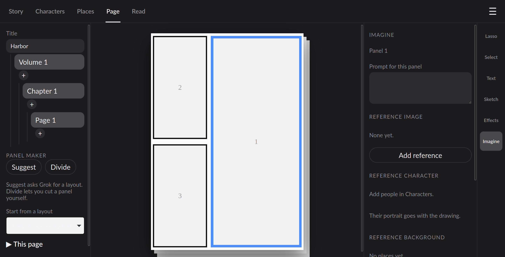
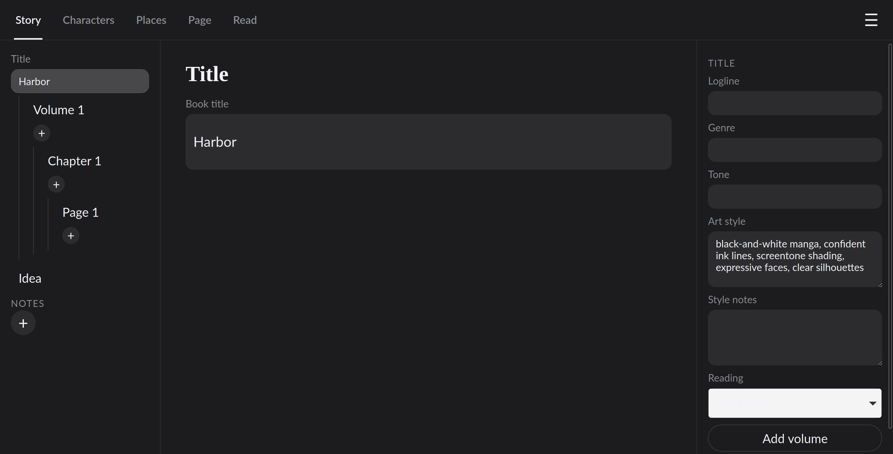
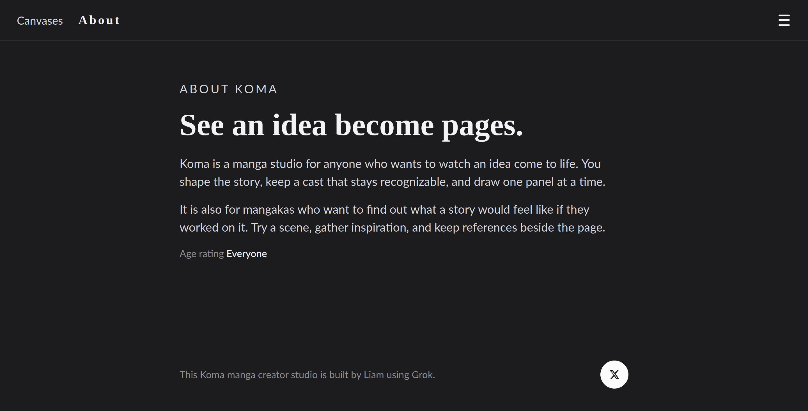
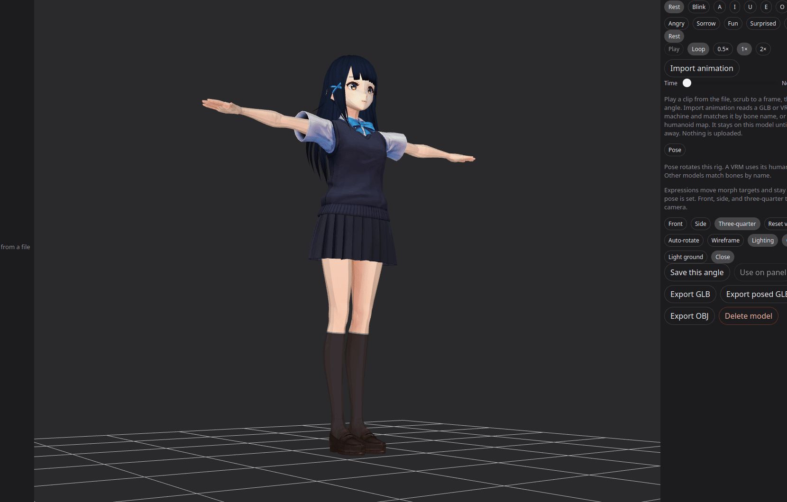
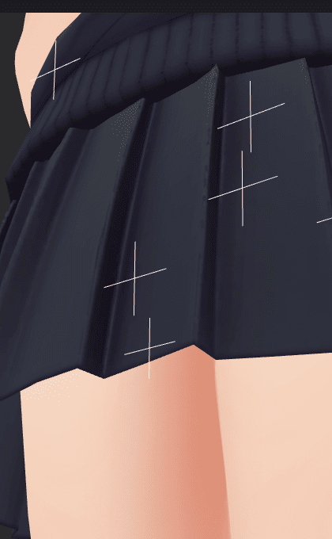
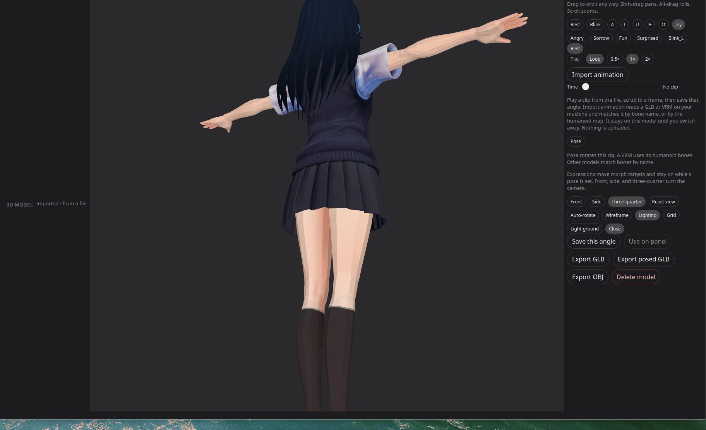
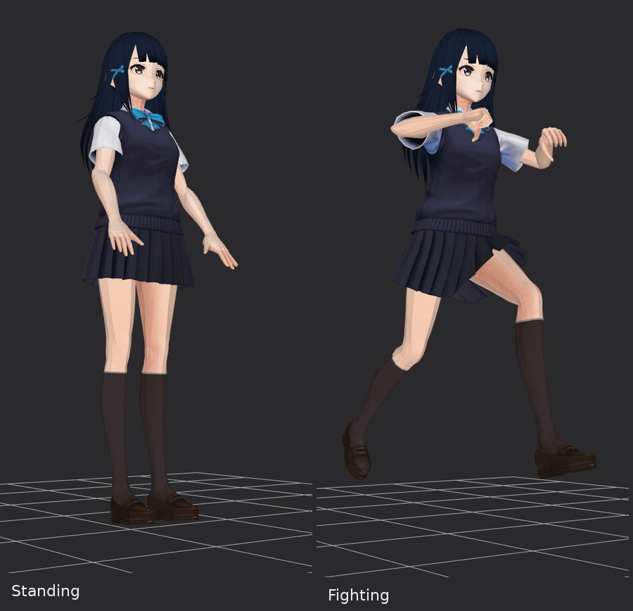
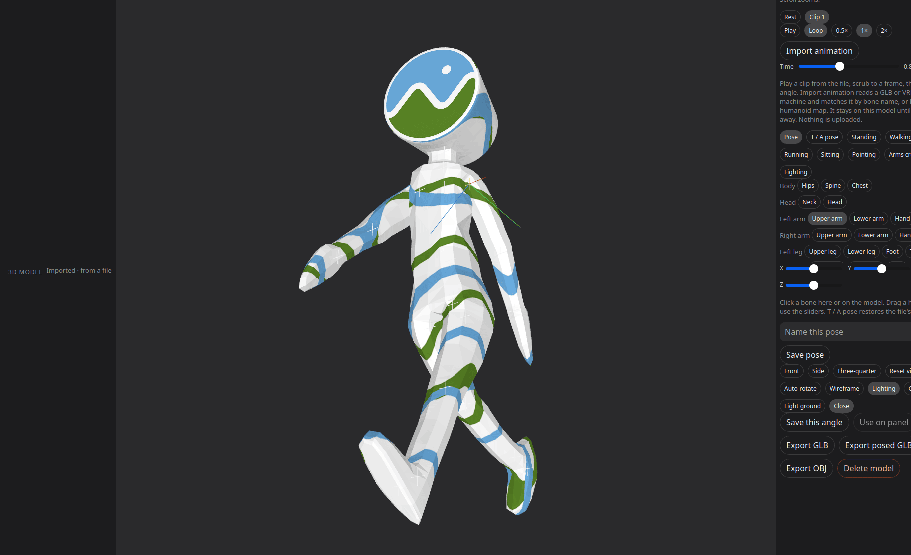

# Koma

> **Work in progress.** Koma is not a finished product. Things may not work properly, features can change or break, and drawing and story planning have not been tested end to end with a real xAI key yet. Use it at your own risk.

Koma is also a concept: an idea of what a free, local, AI-powered manga and illustration studio could be.

Contact the creator <a href="https://x.com/the_lord_liam"></a>

Koma is a local manga studio for Ubuntu. It keeps the book, the drawings, and the API key on your machine. Home shows two canvases: a manga page, and a separate illustration. The manga side plans a series, keeps character designs locked to reference art, draws one panel at a time, letters the page in the app, and exports chapters. The illustration side is one picture, with no panels.

## What Koma does

- **Story:** plans the title, volumes, chapters, and pages from a premise, or lets you write the outline yourself.
- **References:** a board for your own pictures, kept on your computer.
- **Cast:** describes each character and draws a portrait that keeps them on-model.
- **3D models:** builds a model from a prompt or a picture, or imports one, and lets you rotate, zoom, and pan it.
- **Pose and expressions:** bends the model, adds faces and preset poses, and saves the result.
- **Turntable and animation:** plays clips and exports spinning GIFs or PNGs.
- **Pages:** picks a layout and draws each panel, keeping each scene consistent with the panel before it.
- **Draw:** turns your sketch into live AI art, with Tab for a full split screen and support for xAI, a local model, or offline mode.
- **Lines:** pulls clean line art out of a picture, without uploading it.
- **Lasso:** redraws just the part of a panel you circle.
- **Select:** moves and resizes balloons and objects.
- **Text:** suggests editable speech bubbles with AI.
- **Editing:** reorder, duplicate, delete, undo, and redo, with autosave.
- **Export:** print preview, CBZ files, and pages saved to your Documents folder.
- **Privacy:** no tracking, and everything stays on your computer.

## Privacy

Koma has no telemetry, analytics, or tracking, and collects no data. Your books, drawings, 3D models, saved poses, and page undo stay in `~/.local/share/koma`. Settings and your API key stay in `~/.config/koma/config.json` (or in `XAI_API_KEY` if that is already set and the file has no key). Exported pages are written to `~/Documents/Koma/`. The only network traffic is when you use the AI features. Story planning and the bot send that text to xAI (`api.x.ai`) with your own key, and those requests ask xAI not to store them. Drawing can send the prompt and any reference images to the same API, and the picture comes back in the reply. If xAI returns a link to the picture instead, Koma downloads that link and nothing else. Draw can instead post the sketch only to a local address you set in Settings. That address has to be on this machine (`localhost`, `127.0.0.1`, or `::1`). Koma does not follow a redirect away from it, does not add telemetry, and does not contact any other host for that request. With neither an xAI key nor a local address, the live preview is cleaned line art on this machine and the sketch is not uploaded. xAI has no 3D API. A 3D model built with the local backend stays on your machine. That path only contacts xAI when a reference picture has to be drawn first. The first time TripoSR runs, that program downloads its own weights from Hugging Face (`huggingface.co`, model `stabilityai/TripoSR`). It does not upload the character. If you choose Meshy in Settings, the prompt and any reference image go to `api.meshy.ai`, and Koma downloads the model from the HTTPS link Meshy returns. If you choose Tripo, the same happens with `api.tripo3d.ai`. Those services are used only when you select them and generate a model. The X button on the About page only takes you to the creator's X profile.

## What it looks like

Home is two canvases, with a search field above them. Manga opens the book. Illustration is one picture.

<p align="center">
  
</p>

A new manga asks for the title, Japanese or Western, a page size, and the print resolution.

<p align="center">
  
</p>

The page desk keeps the book on the left, the page in the middle, and the Imagine tools on the right.

<p align="center">
  
</p>

Story uses the same chain: title, volume, chapter, and page. The properties for the selected row sit on the right.

<p align="center">
  
</p>

About says who the studio is for. The age rating is Everyone.

<p align="center">
  
</p>

## Open it

The first launch adds **Koma** to the app grid.

```bash
~/koma/bin/koma
```

## What you do

The bar under the title is **Story**, **Characters**, **Places**, **Page**, and **Read**. The menu is **Manga**, **Illustrations**, **Grok bot**, **Shortcuts**, **Settings**, and **About**. **Canvases** returns home. With a book open, the window title is `Koma (Title)`. **?** lists the shortcuts.

### Home and a new book

Home is two canvases, with search above them. **Manga** asks for a title, Japanese manga or Western comics, a finish size, and the resolution, then opens the page. Japanese books read right to left and start from B6. Shinsho, A5, and B5 magazine are the other manga sizes. Western books read left to right and start from a US single issue. Trade, digest, and a European album are the other Western sizes. **Custom** is your own width and height, in millimetres or inches. Resolution is **Screen** (144 dpi), **Print** (300, the usual choice), **Press** (600), or your own dpi. An empty title asks you to name the manga. **Illustration** opens one picture. **+** beside a canvas starts another. The menu under a title switches books. **Delete** on the home canvas, or **Delete manga** in Story, removes that book, its rows, and its image files.

Search looks through manga titles, chapter titles, dialogue, notes, the cast, and names on the reference board. A title or a chapter opens Story. Dialogue opens that page and panel. A note opens the note. A cast hit opens the character. A reference opens the board.

### Story and notes

The left rail shows the title, the open volume, the open chapter, and that chapter's pages. A volume menu picks which volume is open. While a chapter is open, each **+** under the volume, the chapter, or a page adds a page in that chapter. **Add volume** is on the title. **Add chapter** is on the volume.

**Idea** is the premise. **Plan the story** drafts a logline, a cast, places, and chapters from that idea. The draft stays put until you apply it, replacing the outline or appending chapters, or until you discard it. **Editor notes** ask for a change to that draft. A volume has a synopsis. A chapter has a title, a synopsis, and beats, and it can move up, down, or into another volume. **Duplicate chapter** copies the chapter and every page, drawings included, and places the copy just after the original. Deleting a volume keeps its chapters by moving them to another volume. The book always keeps one volume.

**Notes** sit under that tree. Each note has a title and a body, and it is kept with the story, a volume, a chapter, or a page. **References** (**R**) copies pictures already on this computer onto a board for the book: poses, places, colors. Koma keeps that copy with the book. Panel draws use the references you attach on the panel.

On the title you can also set the logline, genre, tone, art style, style notes, and reading direction.

### Characters and 3D

Describe a person, then **Draw portrait**. Later panels send that portrait with the drawing so the face stays recognizable. Turnaround, expression, and pose sheets are optional. **Import portrait** uses a picture already on this machine. The first imported portrait becomes the identity. **Use as identity** picks a different sheet. **Revise reference** changes the selected sheet.

**3D model** builds a mesh **From prompt** or **From references**, or **Import GLB, VRM, or OBJ** keeps a model already on this machine with that character. **From references** uses the identity portrait. On the local builder, **From prompt** uses that portrait when one exists, and draws a reference picture first when it does not. A VRM file is read as a GLB. Textures in the file are shown, and a texture that sits beside the file is copied in with it. The cast list shows a small picture of the model once the viewer has drawn one. The viewer ships with Koma and draws the model on this machine. Drag orbits, Shift-drag pans, Alt-drag rolls, and scroll zooms. **Front**, **Side**, and **Three-quarter** turn the camera. **Outline** draws a thin dark edge and starts off. Expression buttons preview morphs on a rigged file. **Pose** picks a bone from the list or from the model and rotates it with the red, green, and blue handles or the X, Y, and Z sliders. **Fingers** curls both hands. **Mirror** (**M**) copies the left arm and leg onto the right. **T / A pose** restores the file's bind pose. Standing, walking, running, a running mid-stride, sitting, kneeling, crouching, pointing, a wave, arms crossed, and a fighting stance are built in. A VRM uses its humanoid bone map. Other rigs match by bone name. **Save pose** stores the rotations and the current expression on the character. **Reset view**, **Auto-rotate**, **Wireframe**, **Lighting**, **Grid**, **Outline**, **Light ground**, and **Large view** sit under the model. **Save this angle** stores the current view as a PNG on that character. **Use on panel** attaches that picture to the open panel. **Turntable GIF** and **Turntable PNGs** spin the view once and write the frames with the book's exports. **Play** runs a clip stored in the model. Pause, loop, and 0.5×, 1×, and 2× set the playback, and the timeline stops on a frame. **Import animation** reads another GLB or VRM from this machine when the bone names or the humanoid map match, and saves that clip with the model. **Export GLB** and **Export OBJ** write the original model under `~/Documents/Koma/<title>/`. **Export posed GLB** writes a separate file with the pose, the expression, and the paused frame baked in. Pictures of the viewer are in [3D models](#3d-models).

### Places

Add a location, **Draw the place**, or **Import picture** from this machine. **Revise place** changes that view. Attach the place to a panel and it goes out as the background.

### Pages and panels

The page desk has three columns. The left rail is the same title, volume, chapter, and page chain, then **Panel maker**, then **This page**. The page is in the middle. A selected panel has a blue outline. The right strip is the tools, and the column beside it is that tool's properties. Keys **1** through **8** are Lasso, Select, Text, Sketch, Effects, Imagine, Lines, and Draw. Imagine stays available on an open page. The other tools wait until a panel is selected.

**Suggest** asks for one layout from the chapter and the panel actions when an xAI key is saved, and otherwise picks one on this machine. **Start from a layout** chooses a layout directly. A smaller layout asks before it drops panels that already have art or lettering. **Divide** shows a line on the page. Drag the line, rotate it from the middle or from either end, then **Divide** again to cut. The cut snaps so the new panels stay rectangles, and a tilted cut can be straightened. **Cancel** hides the line. The first panel in a right-to-left book stays the one the reader meets first.

**This page** holds **Earlier** and **Later** for the page, **Duplicate page** (drawings and reference images included), **Draw empty panels**, **Print preview** of the lettered page, **Export page**, **Chapter PDF**, **Chapter CBZ**, and **Delete page**. Drag a page in the list, or a panel on the sheet, to reorder it. **Earlier** and **Later**, or **[** and **]**, move the selected panel. **Delete** removes that panel, and the page keeps at least one. **Undo** and **Redo** (**Ctrl+Z**, **Ctrl+Shift+Z**) cover the last 20 edits on that page. Those edits stay on disk after you quit. The header shows **Saving**, then **Saved**.

**Look**, on the Lasso tool, sets the shot, camera, expression, composition, action, and any extra direction. **Draw panel** draws that panel. **Revise panel** asks for a change and stores a new version. Version thumbnails put an older drawing back. **Match the previous panel** sends the last drawing before this one, on this page or the page before it, with a normal draw. Revise and Sketch leave that switch alone. If no earlier drawing exists, Koma says so.

Drawing a panel, revising it, Sketch, and Imagine use the xAI image API. With no key, those actions ask you to add one. Outline, lettering, and export work either way. Draw's live preview can still use a local server or cleaned lines, as below.

### Draw

**Draw** (key **8**) needs a selected panel. The sketch is on the left and the live preview is on the right. The preview updates as you draw, after a short pause, and again when you lift the pen. Pen pressure changes the stroke. **Tab** opens a full-window split: a large sketch on the left and the live render on the right. **Tab** or **Esc** leaves that view and saves the picture onto the panel as a version. Until that save, the preview stays on screen.

Settings picks the preview. **Automatic** uses xAI when a key is saved, otherwise the local address when one is set, otherwise cleaned lines on this machine. **xAI**, **Local server**, and **Cleaned lines** each force that one path. The local request is img2img. The sketch is posted as JSON (`init_images` and `image`) only to the address you typed. That address has to be `localhost`, `127.0.0.1`, or `::1`. A Stable Diffusion WebUI path works, and a ComfyUI-style or other local server can answer the same JSON. The reply is a PNG or JSON with `images` or `image`. The request adds no telemetry. With neither a key nor a local address, the preview is cleaned line art and the sketch stays on this machine.

### Lines

**Lines** (key **7**) extracts black line art from the panel, or from a picture on this computer, onto a clear ground. Strength runs from 1 to 100 and starts at 55. A lower strength keeps the darkest strokes. A higher strength keeps lighter edges too. The extraction runs on this machine and the picture stays here.

### Lasso

**Lasso** (key **1**) is **Select** or **Circle**. Draw around a part of the panel and lift the pen. With a key, that part is drawn again and the rest of the panel stays. With no key, that part is softened in place. The same column holds the prompt, a reference image, a reference background, and **Draw panel**.

### Select

**Select** (key **2**) picks a character, a thing, or the background, and names the current choice. **Select several** keeps more than one. Drag a balloon or a thing on the panel. The corner handle resizes it, and you can edit its text. **Arrange on the panel** places those elements. **Ask Grok to separate** lists the things in the panel from the action. When there is nothing new to use, Koma keeps the things already there, or guesses from the action.

### Text and AI balloons

**Text** (key **3**) holds the dialogue, the balloon, where it sits, and a sound effect. One click sets a speech balloon, a shout, a thought, or a caption. **AI text bubbles** writes balloons from the panel notes. With a key, the model writes the lines. With no key, Koma fills a short template from those notes. The balloons stay editable. Dialogue, captions, and sound effects are lettered by the app, so the words on the page are the words you have. Japanese and other CJK lettering uses a CJK font. A line that also has Latin letters uses a CJK face that can draw both. Latin-only text uses a Latin face when the CJK fonts cannot draw those letters. A long sound effect shrinks until it fits the panel.

### Sketch and effects

**Sketch** (key **4**) draws on the panel with the pen. Lift the pen and, after a short pause, Koma sends that sketch through the image API and stores the refined panel as a version. The prompt is what to keep in the drawing. Pen pressure works here too.

**Effects** (key **5**) sets the atmosphere: Screentone, Speed lines, Rain, Night, Dust, Spark, Quiet, or Harsh light. On a panel that already has a drawing, the choice revises that drawing. On an empty panel, the choice is saved and joins the next draw.

### Imagine

**Imagine** (key **6**) covers the open page, and the selected panel when one is selected. The field reads **Prompt for this page** or **Prompt for this panel**. Add a reference image, pick reference characters so their portraits go with the drawing, and pick a place or import a background picture. **Imagine this panel** draws that panel from its own prompt, cast, and place. **Imagine this page** fills the empty panels. For that pass, an empty prompt, cast, or place on a panel is taken from the page, and a page reference is used when the panel has none of that kind. A panel that already has its own values keeps them. If every panel already has a drawing, Koma says so. More than two empty panels asks before it starts. Click the selected panel again while Imagine is active and the prompt returns to the page.

### Read and export

**Read** shows a chapter as finished pages, two at a time. **Earlier** and **Later**, or the left and right arrow keys, turn the page. A right-to-left book puts the later page on the left. Click a page to edit it. **Chapter PDF** uses the book's finish size. **Chapter CBZ** packs the same pages. **Export page** writes that page as a PNG. Files land in `~/Documents/Koma/<title>/`, one folder per title. **Draw empty panels** here fills the blank panels in the whole chapter. **Refresh** reloads the spreads.

### Illustration

An illustration is one picture, with its own aspect ratio and its own versions. **Draw** and **Revise** use the image API. **Export** writes the current picture. **Delete** removes it. **+** starts another. Opening an illustration from the menu while a manga is open keeps the book underneath.

### Grok bot

**Grok bot** opens a floating window you can drag and resize. Create a bot with a name and a persona, put bots in a group, and write to the group. Each bot replies through xAI, with a short brief of the open book, and the request asks xAI not to store the exchange.

### When something fails

An empty manga, chapter, or character name is refused with a short message. A missing or unreadable panel image is drawn as a plain placeholder, so export still finishes. If the export folder cannot be written, if the library is open in another window, or if the library file is damaged, Koma says which one it is. A page image that cannot be read is reported on its own. A damaged library stops at startup and asks you to move `koma.sqlite` aside.

**Light** and **Dark** in the header switch the studio colors and remember the choice on this machine. The page stays paper-colored.

## API key

Image and story generation use your xAI account (`grok-4.7` for the outline, `grok-imagine-image-2.0` for art).

In Settings, paste a key from [console.x.ai](https://console.x.ai). It is stored in `~/.config/koma/config.json` with permissions `600`. If `XAI_API_KEY` is already set in the environment, Koma uses that until you save a different key. With no key, drawing and planning say to add one. If the API cannot be reached, the message says so and does not include the key.

Resolution defaults to **1k**. Switch to **2k** in Settings for finished pages. Image quality is **low**, **medium**, or **auto**, and that choice is sent with the image request.

Draw’s backend is chosen in Settings. **Automatic** uses xAI when a key is saved, otherwise the local address when one is set, otherwise cleaned lines. **xAI**, **Local server**, and **Cleaned lines** force that one path. The local request is img2img: the sketch is posted as JSON (`init_images` and `image`) only to the address you typed, and the reply is a PNG or JSON with `images` or `image`. Addresses that are not on this machine are refused and are not stored.

You can build the whole outline, letter the pages, and export with no key. Drawing needs one.

## 3D models

Each character can have a 3D model as well as a portrait. Generate it from a prompt, or from the portrait and sheets already on that character, or import a `.glb`, `.vrm`, or `.obj` file from your machine. A `.vrm` file is glTF, so Koma stores it with the other models. Importing reads that file and stores a copy under `meshes/`. Textures packed in the file are kept, including MToon and unlit materials. A texture that sits beside the file (a GLB image path, or an OBJ `.mtl` `map_Kd`) is copied into that copy. It does not upload the model.

### Viewer

**Light** and **Dark** in the header switch the studio colors and remember the choice on this machine. The page itself stays paper-colored. Wireframe, Lighting, Grid, Outline, the ground, and the camera angles update the model in place, so a large file is not loaded again just to change the view.

The viewer ships with Koma. It does not load three.js, `<model-viewer>`, or anything else from a CDN, so it works with no network. It draws the model's base color, so a toon texture shows up instead of a flat stand-in. Separate parts are placed where the file puts them. The camera fits the model's height, width, and depth, so a tall character or a long animal stays in frame. Drag orbits freely, including upside down. Shift-drag pans, Alt-drag rolls, and scroll zooms. Reset view puts the camera back. Auto-rotate spins the model until you turn it off. Wireframe and Lighting can be on together or one at a time. Grid draws a floor under the figure. Outline draws a thin dark edge around the figure and starts off. Turntable GIF writes a short looping movie of one full turn. Turntable PNGs writes the same turn as numbered pictures. Both land in `~/Documents/Koma/<title>/`. Light ground switches the backdrop. Large view fills the window; Close, or Escape, leaves it. On a desktop that allows it, Large view also asks the window to go fullscreen.

Sendagaya Shino (CC0) in the Standing pose, arms down, from a three-quarter front. Grid and lighting are on, and the camera and display controls sit beside the model. The pose handles are hidden.

<p align="center">
  
</p>

### Textures

The viewer draws the texture packed in the file, so a toon model keeps its painted face and clothes.

The same model, head and shoulders. The painted face and the sailor uniform are the texture from the file.

<p align="center">
  
</p>

### Expressions

Expression buttons add the model's morph targets (a VRM blink or a vowel shape). An expression can stay on while the pose changes.

Rest, Joy, and Surprised, still head and shoulders. Joy narrows the eyes and lifts the mouth. Surprised opens the eyes and the mouth.

<p align="center">
  
</p>

### Posing

Pose mode bends a rigged GLB or VRM. Pick a bone in the list, grouped by body part, or click it on the model, then drag the red, green, and blue handles or move the X, Y, and Z sliders. The Fingers slider curls both hands from open to a fist. Show bones turns those markers and handles off when you want a clean view. It starts on. T / A pose puts back the bind pose stored in the file, which is a T-pose or an A-pose depending on how the model was rigged. Standing, walking, running, a running mid-stride, sitting, kneeling, crouching, pointing, a wave, arms crossed, and fighting stance aim the limbs. Wave keeps the head level and the raised hand beside it. Kneeling, crouching, and the mid-stride plant the lower foot on the floor. VRM files use the humanoid bone map. A rig without that map is matched from bone names such as `LeftUpperArm` or `mixamorig:LeftArm`. Save pose stores the bone rotations and the current expression in the library under that character. Load puts them back. Nothing about posing is uploaded.

Standing on Sendagaya Shino, from a three-quarter front, with the floor and lighting on. The arms hang down.

<p align="center">
  
</p>

### Animation

A model that already has animation clips lists them under the viewer. Play and pause, a loop switch, and 0.5×, 1×, and 2× set the speed. The timeline stops on any frame. Save this angle and Use on panel capture that frame, expression included. Import animation opens a GLB or VRM from your machine and plays it on this rig when the bone names match, or when both files share a humanoid bone map. An imported clip is saved with that model on your machine and is listed the next time you open it. It is not uploaded. Root travel on a walk is held in place so the figure stays in frame; the legs still move.

Clip 1 paused at 0.80 seconds, one step into the walk, from a three-quarter front. CesiumMan by Cesium, licensed CC-BY 4.0.

<p align="center">
  
</p>

Save this angle writes a PNG of the posed model, expression included, next to the character's other pictures. It does not upload it. Use on panel copies that picture onto the open panel as a reference, the same way an imported panel reference is used when the panel is drawn. The cast thumbnail is a small copy of the view and is removed with the model. Named poses are rows in the library database, deleted with the character or the project, and they are not sent anywhere. Export GLB and Export OBJ write the model you imported or generated. Export posed GLB writes a new file beside those, with the current pose, expression, and animation frame baked into the vertices. The stored model is left as it was.

The default provider is **local TripoSR**. xAI's API covers text, images, video, and voice, and it has no 3D endpoint, so Koma does not pretend to call one. TripoSR is MIT-licensed, it is the lightest of the open image-to-3D tools that fit this app, and it does not need a credit card. It turns one picture into a mesh. A prompt with no portrait is drawn first with xAI, then lifted. A GPU with about 6 GB free is comfortable. CPU works and is slow, often several minutes for one character. CUDA builds of PyTorch have to match the driver; a CPU build is enough to start.

Koma does not ship the weights. Install TripoSR beside the library and install its Python packages:

```bash
git clone https://github.com/VAST-AI-Research/TripoSR.git ~/.local/share/koma/backends/triposr
python3 -m pip install --user torch --index-url https://download.pytorch.org/whl/cpu
python3 -m pip install --user -r ~/.local/share/koma/backends/triposr/requirements.txt
```

Koma finds that folder and runs `extras/mesh/triposr_glb.py`. Until it is installed, Generate says the backend is not installed and how to set it up. Another image-to-3D tool can be used by setting **Local 3D command** in Settings (or `KOMA_MESH_CMD`) to a program that accepts `image.png --output model.glb`. An OBJ written to that path is turned into a GLB. Hunyuan3D and TRELLIS need much more GPU memory and have narrower licenses, so they are not the default. Stable Fast 3D is a similar size to TripoSR, and its license limits some commercial use, so it stays optional behind that command.

**Meshy** and **Tripo** are optional hosted providers. Paste your own key in Settings. It is stored in the same private config file. `MESHY_API_KEY` and `TRIPO_API_KEY` are used when the file has no key for that service. Hosted text-to-3D sends the prompt. Hosted image-to-3D sends one reference picture. Both download a GLB over HTTPS. They bill the account on that key, so they are not the default. A missing key is reported in the studio and the key is not repeated in the error.

## Where files live

| What | Where |
| --- | --- |
| Project database | `~/.local/share/koma/koma.sqlite` |
| Generated images | `~/.local/share/koma/images/` |
| 3D models | `~/.local/share/koma/meshes/` |
| Page undo | `~/.local/share/koma/history/` |
| Exports | `~/Documents/Koma/<title>/` |

Deleting a character removes that character's portraits, 3D models, and saved poses. Deleting a project removes its database rows, image files, 3D models, and saved poses.

## Get the source

```bash
git clone https://github.com/the-lord-liam/koma.git
```

The repository is public. Use Fork on GitHub to start your own copy.

## Make it your own

You're welcome to fork Koma, but you don't have to stop there. Feel free to take the idea and the concept and run with them in your own projects, whether that's building your own manga studio from scratch or remixing pieces of this one. No need to ask. If Koma sparks something, I'd love to see what you make.

## License

Koma is free and open source under the [MIT license](LICENSE). Fork it, change it, and share your version. The copyright notice in that file needs to stay with the copies you share.

An xAI API key stays on your machine, in `~/.config/koma/config.json` or in `XAI_API_KEY`. It is not part of this repository.
